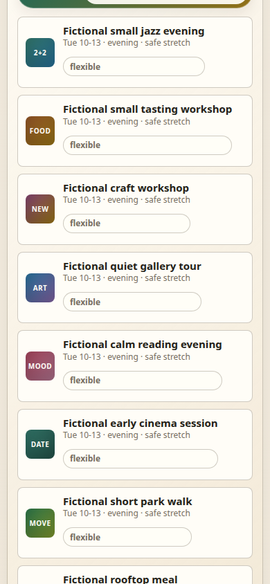
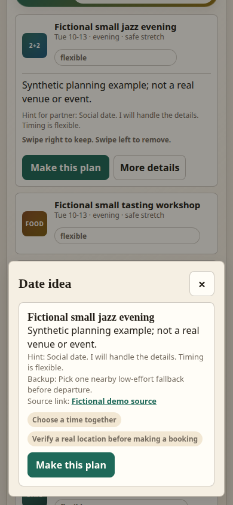
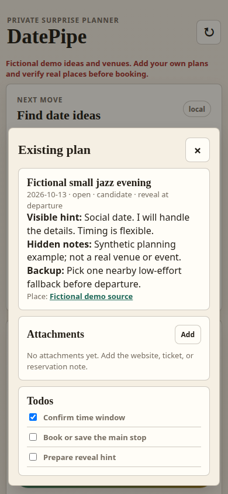

<div align="center">

# 💌 DatePipe

### Make room for a little magic.

**A thoughtful evening starts with a small idea.**  
DatePipe helps you turn that idea into a plan, keep the surprise intact, and remember the details that make it special.

**Find an idea · Plan the moment · Keep the surprise**

[**See the demo ↓**](#see-datepipe-in-action) &nbsp;·&nbsp; [**Run it locally →**](#try-it-in-a-minute) &nbsp;·&nbsp; [**Explore the code →**](#made-for-tinkering)

<br>


</div>

---

## See DatePipe in action

**Three steps from “we should do something” to “it's all planned.”**

<table>
  <tr>
    <td align="center" width="33%">
      <a href="docs/screenshots/discovery.png"></a>
    </td>
    <td align="center" width="33%">
      <a href="docs/screenshots/planning.png"></a>
    </td>
    <td align="center" width="33%">
      <a href="docs/screenshots/plan.png"></a>
    </td>
  </tr>
  <tr>
    <td align="center"><strong>01 · Discover</strong><br><sub>Start with an idea that fits the evening.</sub></td>
    <td align="center"><strong>02 · Prepare</strong><br><sub>Keep the reveal, backup, and practical bits together.</sub></td>
    <td align="center"><strong>03 · Remember</strong><br><sub>Save the plan and check things off.</sub></td>
  </tr>
</table>

<sub>Real browser captures at a 390 × 844 phone viewport. All examples, venues and links are deliberately fictional. This is a responsive **browser** prototype, not a native Android or iOS app.</sub>

---

## The nicest moments deserve a little less admin

A date night shouldn't need a spreadsheet. And a surprise is rather less surprising when the details are scattered across half a dozen apps.

DatePipe gives the planning process one quiet home:

| | |
|:--|:--|
| **✨ Ideas for the evening** | Browse a fictional idea library and explore matches for available time windows. |
| **🎁 A surprise worth keeping** | Keep a reveal hint alongside the details you don't want to forget. |
| **🧭 A plan B** | Attach a fallback to your plan for when real life develops opinions. |
| **☑️ The little things** | Keep notes, attachments and a checklist with the plan. |
| **💾 Pick up where you left off** | Saved plans and checklist states persist across server restarts. |

> **Made for planning together, and for keeping a little mystery until the right moment.**

The repository also contains prototype account and trusted-accomplice fields. They are **not** a verified online collaboration service.

## Try it in a minute

No account, API key, paid service or Python package installation is required for the local demonstration.

**Requirements:** Python 3.11+ on a Unix-like system. The verified setup was Linux / Python 3.14.4.

```sh
git clone https://github.com/jedufa/datepipe.git
cd datepipe
python3 server.py --host 127.0.0.1 --port 8812
```

Open **[http://127.0.0.1:8812/](http://127.0.0.1:8812/)** in a browser **on the same machine**.

Try this: complete the fictional onboarding → find an idea → choose **Make this plan** → edit the hint or backup → check off an item → restart the server and find your plan again.

**What this demo is:** a working local planning workflow with synthetic suggestions.  
**What it isn't:** live venue research, actual booking, real calendars or a hosted couples platform.

## Made for tinkering

The interesting part isn't only the interface. DatePipe is also a compact example of a local-first web application that keeps its default runtime simple.

```text
DatePipe
├── server.py              Local HTTP entry point
├── static/                Responsive browser interface
├── datepipe_backend/      Matching, planning, persistence, boundaries
├── data/                  Fictional city and date-idea examples
├── tests/                 Backend and web regression checks
└── docs/                  Build notes and genuine UI captures
```

**Verified preparation:** 103 backend/web tests passed. Nine rendered Chromium checks covered onboarding, planning, checklist updates, mobile layout and persistence after a separate server restart. Those checks found and helped fix a frontend sorting crash and mobile overflow.

To inspect the tests:

```sh
python3 -m venv .venv
.venv/bin/python -m pip install --require-hashes -r requirements-dev.txt
.venv/bin/python -m pytest -q -p no:cacheprovider tests/backend tests/web
```

Node 22.22.1 was also used for frontend checks. See [build and test details](docs/BUILD_AND_TEST.md) and the [changelog](CHANGELOG.md).

## Your plans should stay yours

DatePipe is deliberately a **trusted, single-machine prototype**:

- The server binds to IPv4 loopback and checks Host/Origin/fetch-site boundaries.
- Backend outbound HTTP is off by default. Optional provider, geocoding or AI paths require explicit `DATEPIPE_ALLOW_NETWORK=1` and are **unverified**; they may send planning or location data externally.
- Plans and reports live in ignored local runtime files; browser preferences use localStorage. **This is not encrypted storage.**
- It is **not safe to expose as a public, shared-machine or production web service**. The browser's default context does not enforce separation from other local processes.

[Read the security boundaries →](SECURITY.md)

## An invitation to take it further

This is an **experimental, source-only prerelease**. Native mobile clients, real venue accuracy, hosted sharing, provider integrations and production-grade security were not verified. No mobile binary or online service is included.

DatePipe is **unmaintained and looking for a maintainer**. The source is available to study, adapt or fork independently. There is no promise of issue triage, pull-request review, security updates or new releases.

[**Fork the project →**](https://github.com/jedufa/datepipe/fork) &nbsp;·&nbsp; [**Contributing guide →**](CONTRIBUTING.md) &nbsp;·&nbsp; [**Latest source prerelease →**](https://github.com/jedufa/datepipe/releases/tag/v0.1.0-oss.1)

First-party source and tests: **[MIT License](LICENSE)** · Copyright © 2026 Jean-Francois Dufour. [Third-party notices](THIRD_PARTY_NOTICES.md) retain their own terms.

---

<div align="center">

### A little less planning friction. A little more anticipation.

*Make time for each other. Keep the surprise.*

</div>
